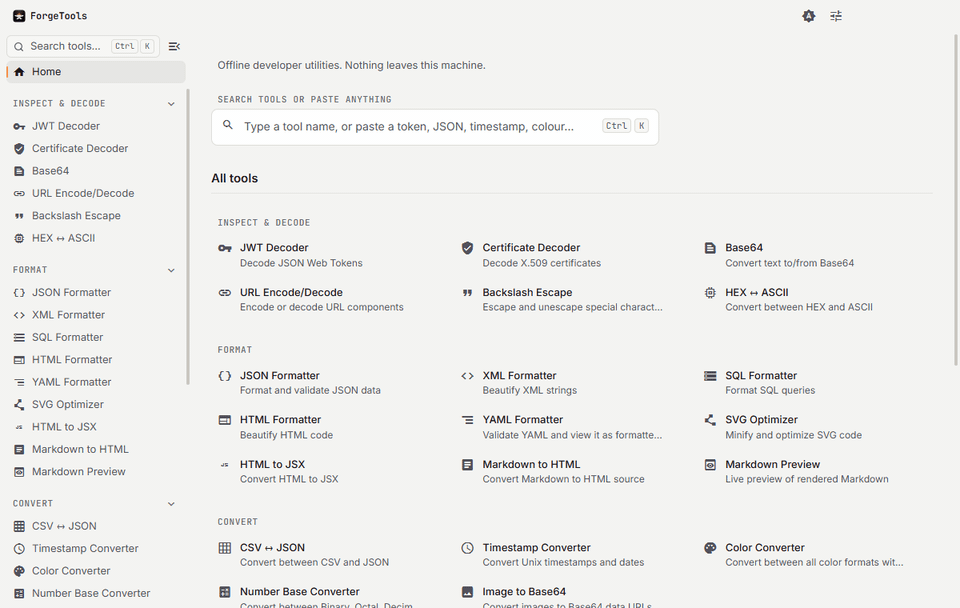

<h1>
  
  ForgeTools
</h1>

Offline developer utilities in one desktop app. Format, decode, convert and generate without anything you paste leaving your machine.



## Highlights

- **100% offline**: everything runs locally, and inputs stay in memory (unless you turn on input history).
- **Paste anything**: drop a JWT, JSON, timestamp or colour on the home screen and ForgeTools opens the right tool.
- **Keyboard-first**: `Ctrl/Cmd+K` to jump to any tool, `Ctrl/Cmd+Shift+C` to copy output, `F1` for tool help.
- **Pipeline**: chain decode, decompress, format and hash steps into one recipe, with a partial result if a step fails.
- **Sample button in every tool**: one click loads realistic input so you can see what a tool does.
- **Opt-in input history**: off by default; when on, recent inputs are kept per tool. Tools that handle secrets never record, and secret-looking text is skipped.
- **Light and dark themes** that follow your system.
- **Lives in the tray**: closing the window keeps it running, with an optional global shortcut and start at login (see [Background mode](#background-mode)).
- **Locked down**: sandboxed renderer, strict Content Security Policy, sanitized Markdown preview, and no network access. The one exception is an opt-in update check (a button in Settings → About, plus an optional daily check that is off by default) that only asks GitHub for the latest release number.
- **Fast startup**: each tool loads its libraries only when you open it, and the app ships no runtime `node_modules` beyond four small main-process libraries (QR, barcode, SVG).
- Runs on **Windows, macOS (Intel & Apple Silicon) and Linux**.

## Tools

| Category | Tools |
| --- | --- |
| **Inspect & Decode** | JWT Decoder, Certificate Decoder (X.509), Base64, URL Encode/Decode, Backslash Escape, HEX ↔ ASCII, HMAC Generator/Verifier, CSR Decoder, SAML Decoder, URL Parser, User-Agent Parser, IP/CIDR Calculator, Gzip/Deflate, Protobuf/MessagePack, Unicode Inspector, Dockerfile Linter |
| **Format** | JSON, XML, SQL, HTML, YAML, SVG Optimizer, HTML to JSX, Markdown to HTML, Markdown Preview, CSS/SCSS/JS Beautify & Minify, GraphQL |
| **Convert** | CSV ↔ JSON, Timestamp, Color, Number Base, Image to Base64, JSON ↔ YAML, JSON → Types (TS/Go/Rust/C#/Python), TOML ↔ JSON, .env ↔ JSON, PEM ↔ JWK, cURL → Code, docker run ↔ compose, Chmod, Data Size, Time Zones |
| **Text & Utilities** | String Case, RegExp Tester, String Inspector, Hash Generator (MD5/SHA-1/SHA-256/SHA-512), Cron Parser, JSONPath Query, Password Strength, bcrypt/Argon2, HTTP Status Codes, Cheat Sheets, Pipeline (chain tools) |
| **Generate** | UUID/ULID, QR Code, Barcode (EAN-13, UPC, CODE128, CODE39), Lorem Ipsum, Random String, JWT Encoder/Signer, Key Pair (RSA/EC/Ed25519, PEM/SSH/JWK), Fake Data, Cron Builder, .gitignore, Favicon |
| **Compare** | Text Diff (line, word, char), JSON Diff (structural) |

## Background mode

Closing the window keeps ForgeTools running in the system tray (the menu bar on macOS). Quit from the tray menu, or with `Cmd+Q` on macOS.

In **Settings** you can:

- turn off **Keep running in background** to quit when the window closes;
- enable **Start at login**, which launches ForgeTools hidden in the tray;
- set a **global shortcut** (none by default; try `Ctrl+Alt+Space`) that opens ForgeTools on Home with the search box focused, or hides it if it is already focused.

## Download

Get the latest build from [Releases](https://github.com/tengfone/forgetools/releases/latest):

| Platform | File |
| --- | --- |
| Windows | `ForgeTools-Portable-X.Y.Z.exe` |
| macOS (Intel) | `ForgeTools-X.Y.Z-mac-x64.zip` |
| macOS (Apple Silicon) | `ForgeTools-X.Y.Z-mac-arm64.zip` |
| Linux | `ForgeTools-X.Y.Z.AppImage` |

> The macOS build is unsigned. On first launch, right-click the app and choose **Open**.

## Development

Requires Node.js 26 (see `.nvmrc`).

```bash
git clone https://github.com/tengfone/forgetools.git
cd forgetools
npm install
npm run dev        # run with hot reload
npm run test:unit  # unit tests (Vitest)
npm test           # end-to-end tests (Playwright; run `npm run build` first)
npm run dist       # package for your platform into dist/
```

To re-record the demo GIF above, run `npm run build && node scripts/record-demo.js` (needs ffmpeg on PATH).

To release, run `npm run release:patch` (or `release:minor` / `release:major`). It tags the version, and once tests and all platform builds pass, CI publishes the GitHub release automatically. Only the 10 newest releases are kept; older ones are deleted (their git tags stay).

## License

[MIT](LICENSE)

---

Built with Electron, TypeScript, Tailwind CSS and Monaco Editor. Developed with assistance from Anthropic's Claude.
